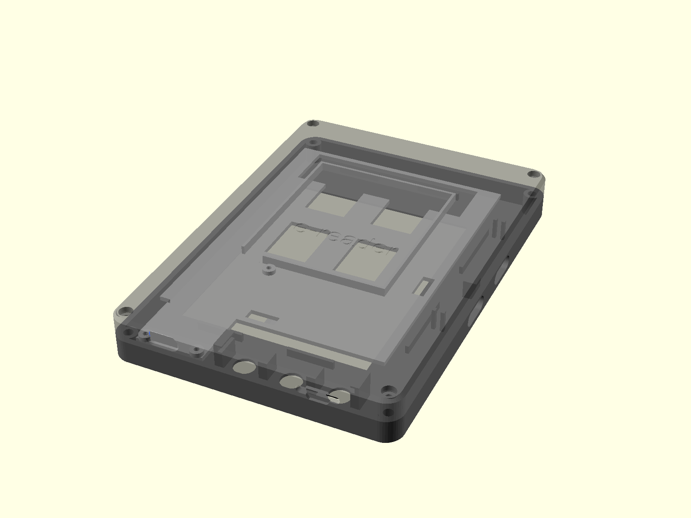

# DIY e-reader

A pocket e-reader built around a **Waveshare 4.2" e-Paper Module V2** (400 × 300, black/white + 4 grays),
an **ESP32-S3** (Unexpected Maker FeatherS3), a microSD card and a 3D-printed case.
It reads books in portrait at 300 × 400, sleeps between page turns and runs for weeks on a 1500–2000 mAh LiPo.



| | |
|---|---|
| **Formats** | `.txt`; **EPUB** laid out on the device (bold/italic, headings, pictures, table of contents); **PDF / comics** pre-rendered on your computer with [`xtconvert`](tools/converter) into `.xtp` |
| **Controls** | PREV / NEXT on the grip edge (left by default, `left_handed` in `cad/params.scad`), MENU / OK / BACK below the screen; long press jumps 10 pages |
| **Getting books on** | microSD card now; Wi‑Fi upload page and USB mass storage (milestone 6) |
| **Case** | ~95 × 137 × 17 mm, parametric OpenSCAD, fits a Bambu A1 mini |

## Repository
| Folder | What's inside |
|---|---|
| [`hardware/`](hardware) | [Bill of materials](hardware/BOM.md), [wiring](hardware/wiring.md) |
| [`cad/`](cad) | OpenSCAD case: `params.scad` holds every dimension; `make` exports STLs and runs a collision check |
| [`firmware/`](firmware) | PlatformIO project (Arduino on ESP32-S3) |
| [`tools/converter/`](tools/converter) | `xtconvert`: PDF / CBZ / images → `.xtp` |
| [`docs/`](docs) | [Assembly](docs/assembly.md), [printing](docs/printing.md) |

## Quick start
1. Buy the parts in the [BOM](hardware/BOM.md) and wire them per [wiring.md](hardware/wiring.md) (breadboard first).
2. Flash the firmware:
   ```bash
   cd firmware && pio run -t upload
   ```
3. Format a microSD card as FAT32, make a `books/` folder and copy `.epub` and `.txt` files and converted PDFs into it:
   ```bash
   cd tools/converter && uv run xtconvert ~/Downloads/paper.pdf --mode width -o /Volumes/SD/books/
   ```
4. Measure your display module, set the values in `cad/params.scad`, print the fit test, then the case ([printing.md](docs/printing.md)).
5. Assemble ([assembly.md](docs/assembly.md)).

## Development
```bash
cd firmware && pio test -e native          # layout, EPUB, zip, image and .xtp unit tests on your computer
cd tools/converter && uv run pytest        # converter tests
make -C cad                                # STLs + collision check (needs OpenSCAD 2024+)
make -C cad png                            # preview renders
```

## EPUB on the device
The first time a book is opened, the reader converts it once into cache files in `/.reader/` on the card
(this takes a few seconds to about a minute with many pictures; the panel shows the progress).
After that, opening, turning pages and changing the font size are as fast as with `.txt` files.
MENU → **Contents** jumps to a chapter.

Supported: EPUB 2 and 3, chapters in reading order, headings, bold and italic, alignment, blockquotes,
lists, line breaks, page breaks from CSS, JPEG (baseline) and PNG pictures dithered to the panel,
and the table of contents from the nav document or the NCX.
Not supported: DRM-protected books (the reader says so), GIF/SVG and progressive JPEG pictures (left out),
characters outside Latin-1 (shown as the nearest Latin letter or `?` until the TTF fonts arrive), footnote pop-ups.

## Status / roadmap
- [x] Hardware design, wiring, BOM
- [x] Parametric case with collision check
- [x] PDF/comic converter and `.xtp` format
- [x] Firmware: display, buttons, SD, deep sleep + wake on any button, library, TXT reader with justified text and cached pagination, `.xtp` viewer, font sizes, saved positions
- [ ] Bring-up on real hardware (pin check, Rev2.2 `PWR` pin, rotation, battery scale)
- [ ] Anti-aliased fonts generated from TTFs, hyphenation
- [x] EPUB (unzip, OPF/spine, XHTML + CSS subset, images, table of contents)
- [ ] True 4-gray refresh for PDF pages (currently 2×2 dithered B/W)
- [ ] Wi‑Fi upload page, USB mass storage
- [ ] Optional KiCad carrier PCB (draft in tag `carrier-pcb-draft`)
