# Assembly

Time: about 2–3 hours plus printing.

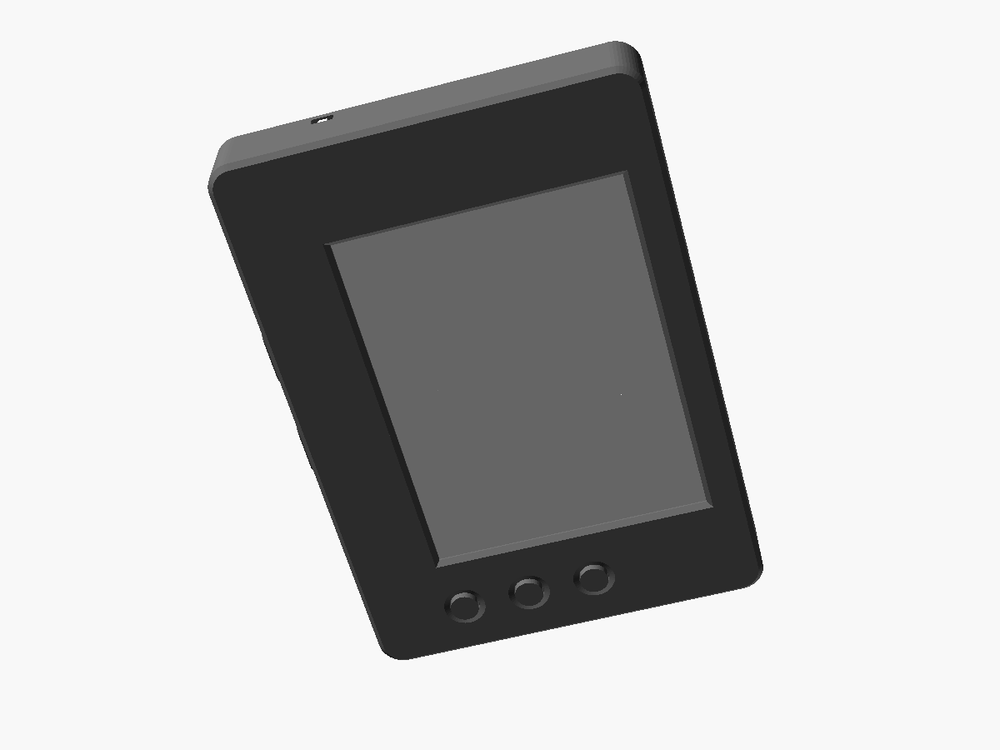

**You need:** the parts from the [bill of materials](../hardware/BOM.md), the printed case ([printing.md](printing.md)),
a soldering iron, flush cutters, calipers, a multimeter and a heat-set insert tip (or the soldering iron at ~220 °C).

The 3D pictures below come straight from the CAD model and follow `cad/params.scad`
(for example `left_handed`). After changing the model, run `make -C cad steps` to redraw them.
In every picture the part you add in that step is **orange** (printed parts) or shown in its own colour (electronics).
Steps 1–7 of section 4 are seen **from the back**, because the reader is built lying face-down.

---

## 1. Breadboard bring-up (before soldering anything permanently)

Wire everything with jumper wires first. The pin names are the same as in [wiring.md](../hardware/wiring.md)
and [`firmware/include/pins.h`](../firmware/include/pins.h).

> ⚠️ Check every pin against Adafruit's pinout diagram for the ESP32-S3 Feather before soldering.

**Display:**

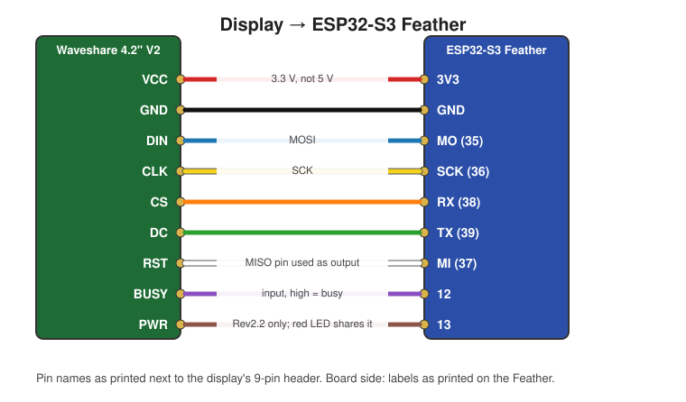

1. Wire the display to the Feather as shown above.
2. `cd firmware && pio run -t upload && pio device monitor`
   (if the upload does not find the board: hold BOOT, tap RESET, release BOOT, try again)
3. Without an SD card you should see **"Storage: No microSD card"** on the display. That proves SPI, `PWR`, `BUSY` and rotation.
   - Upside down? Change `DISPLAY_ROTATION_PORTRAIT` in `firmware/include/config.h` (1 ↔ 3).
   - Nothing happens and the log shows "Busy Timeout": check `BUSY` and `PWR` (Rev2.2 needs `PWR` high).

**microSD breakout:**

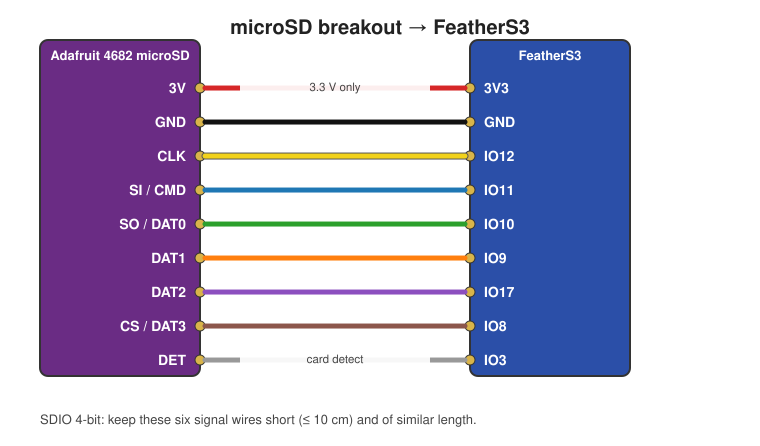

4. Add the SD breakout and the buttons (section 3), then put a card with `/books/*.txt` in it. The library should appear.
   The breakout's DET pin stays unconnected (no pin left on the Feather).

**Power:**

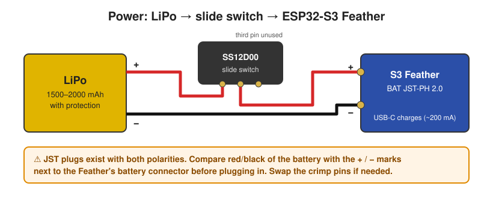

5. Plug in the battery. The % in the header comes from the Feather's battery monitor; `--%` means the firmware found none (check the serial log).
   The red LED on the Feather is lit while the reader is awake: it shares pin 13 with the display's `PWR` line.

---

## 2. Prepare the display module

- Remove (desolder or clip) the straight pin header on the back if it is fitted, and solder thin silicone wires
  directly to the pads. Keep the side-entry connector only if `mod_back_clear` in `params.scad` allows it.
- Stick 1 mm foam tape on the back of the board where the chassis feet press (near the corners).
- Leave the wires about 12 cm long; they run through the opening in the chassis plate to the Feather.

---

## 3. Button boards

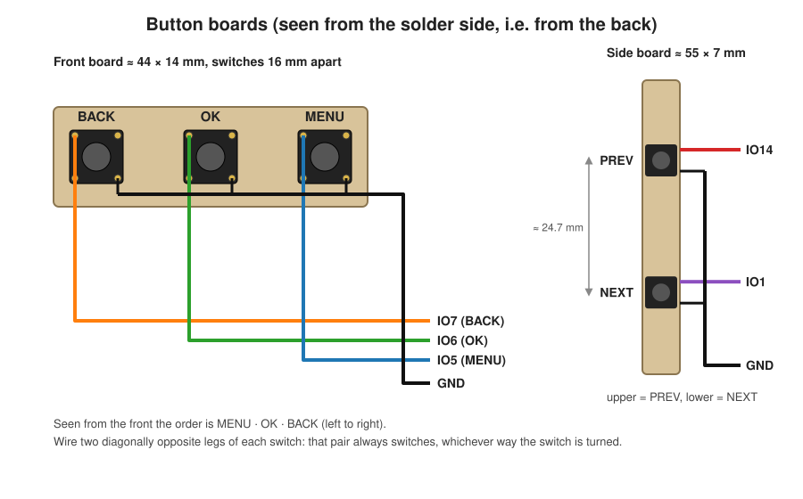

- **Front:** a strip of perfboard (≈ 44 × 14 mm) with 3 tactile switches 16 mm apart, switches facing the front.
  Seen from the front they read **MENU · OK · BACK** from left to right; from the solder side it is the other way round.
- **Side:** a strip (≈ 55 × 7 mm) with 2 switches, **PREV** upper and **NEXT** lower, at the distance printed by
  `echo(side_btn_y)` in OpenSCAD (default ≈ 24.7 mm). It sits on the grip edge: left with `left_handed = true`
  in `params.scad`, right with `false`.
- One common GND wire per board, one signal wire per button. Use two diagonally opposite legs of each switch.

---

## 4. Case

### Step 1 – Heat-set inserts into the bezel

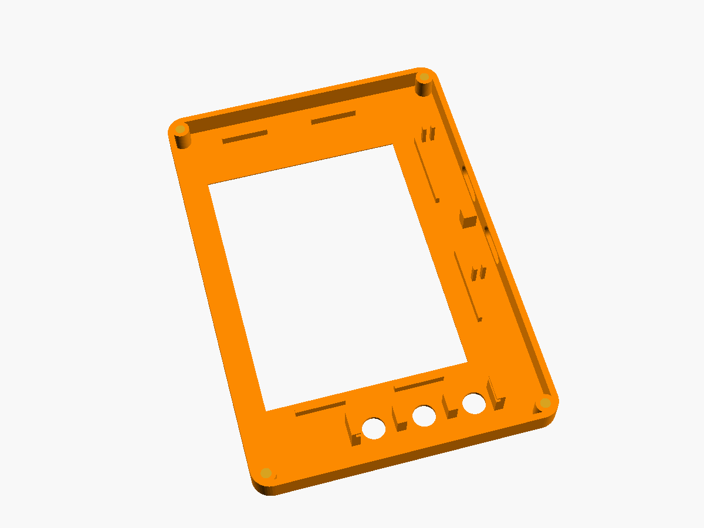

1. Lay the bezel face-down on a clean, soft cloth.
2. Press the 4 M2 heat-set inserts into the corner bosses (~220 °C for PLA, ~245 °C for PETG), slightly below flush.

**Check:** the inserts sit straight; a screw turns in by hand.

### Step 2 – Button caps

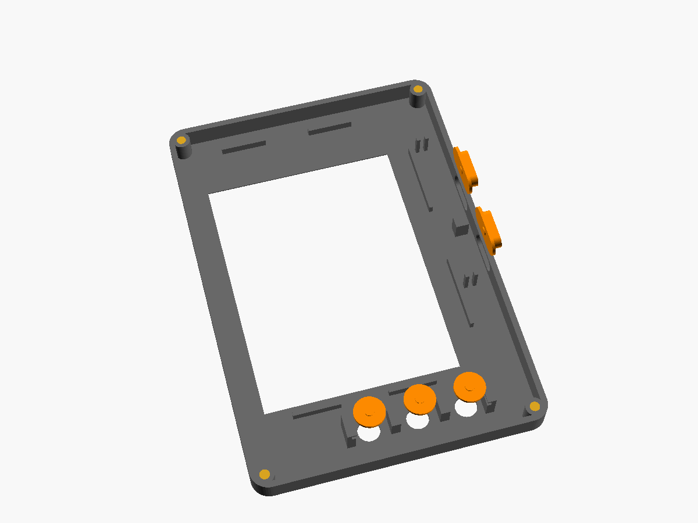

1. Drop the 3 round caps into the holes below the window, flange inwards.
2. Put the 2 oval caps into the slots on the grip edge, flange inwards.

**Check:** every cap moves freely. If one sticks, raise `hole_tol` to 0.3–0.35 mm and reprint the caps.

### Step 3 – Button boards

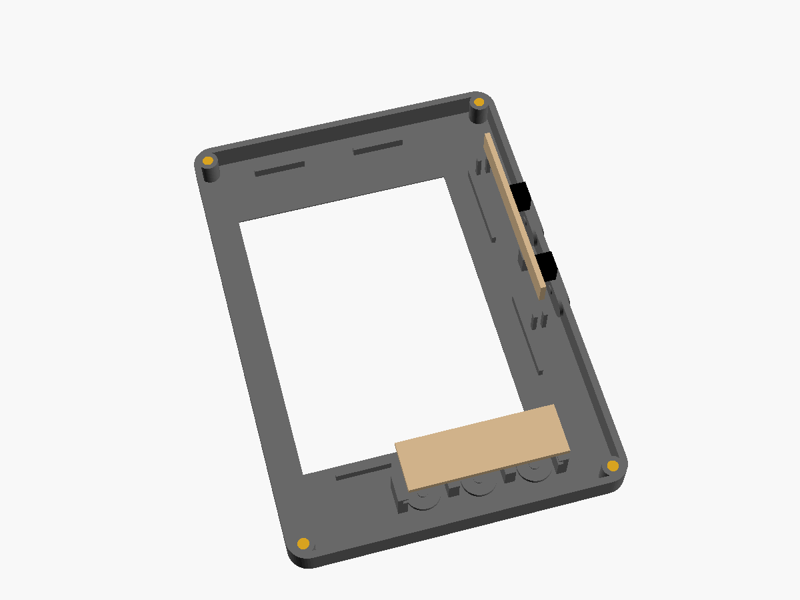

1. Slide the front board into the two slotted posts, switches towards the caps. It rests on the two spacers.
2. Slide the side board into its posts on the grip edge, PREV at the top.

**Check:** press each cap — you feel and hear a click, and the cap springs back.

### Step 4 – Display

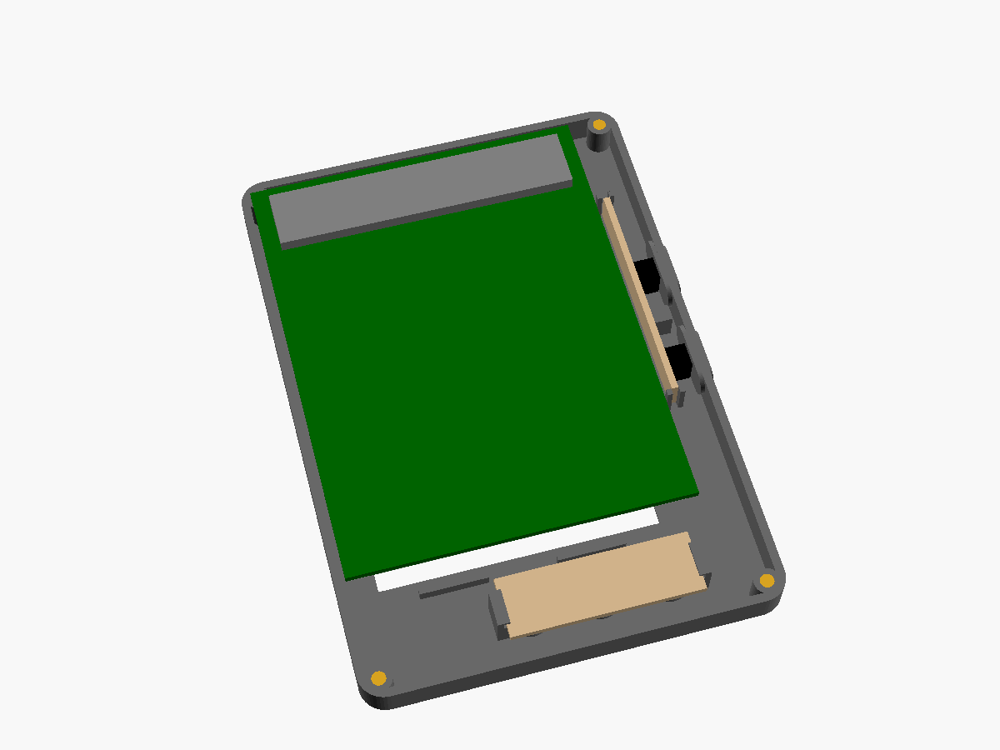

1. Remove the panel's protective film if you like (or leave it on until the end).
2. Lay the display face-down between the ribs, **connector and driver area at the top**.
3. Lead its wires out at the top.

**Check:** the active area is centred in the window (the fit test from [printing.md](printing.md) told you this already).

### Step 5 – Chassis, Feather and battery

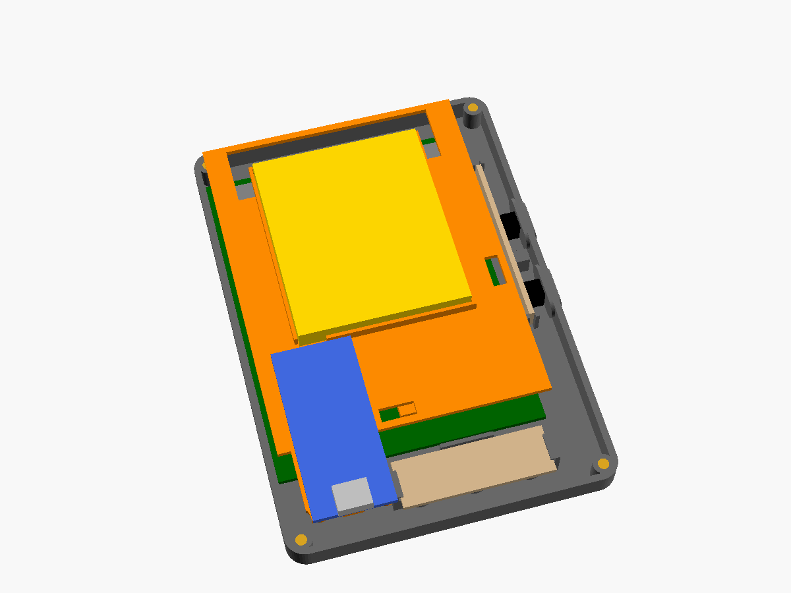

1. Screw the Feather onto the chassis standoffs (4 × M2 × 4 self-tapping), **USB-C towards the bottom edge**.
2. Put the battery into its pocket, leads towards the Feather. Kapton tape between battery and anything sharp.
3. Wire everything (sections 1 and 3); route the wires through the slots in the plate.
4. Place the chassis onto the display: its feet rest on the foam tape, the tongue under the Feather rests on the front face.

**Check:** no wire lies under a foot or between the plate and the display.

### Step 6 – Back shell: microSD and power switch

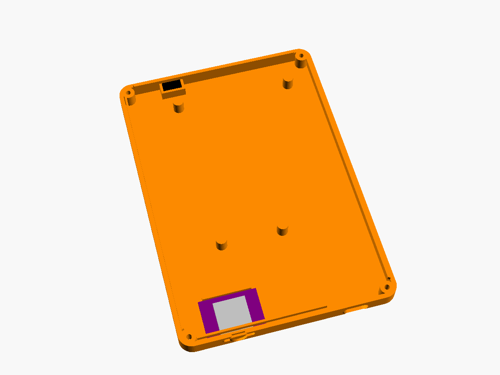

The back shell is shown turned over, inside up.

1. Stick the SD breakout onto its posts (double-sided tape), **card slot towards the bottom edge**, against the back stop.
2. Push the slide switch into its holder at the top edge, lever through the slot.
3. Solder the switch in series with battery + (see the power diagram in section 1).

**Check:** a card slides in through the slot in the bottom edge and clicks into the socket.

### Step 7 – Close the case

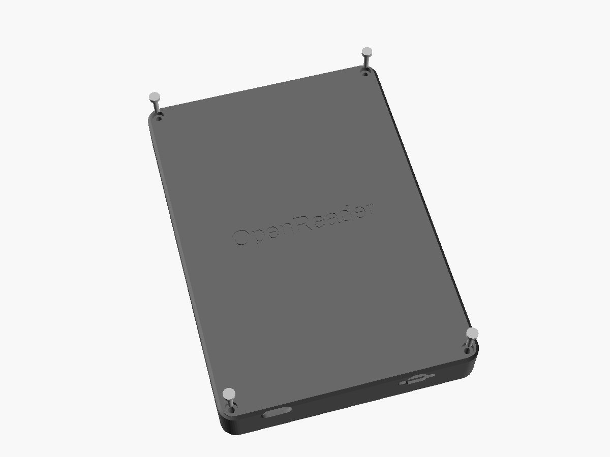

1. Turn the back shell over and put it onto the bezel; the lip goes inside the bezel wall. Tuck in all wires.
2. Fit the 4 × M2 × 8 screws. Tighten gently — the pegs in the back shell press the chassis and the display forward.

**Check:** the seam is closed all round, USB-C and the SD slot line up with their openings.

---

## 5. First start

Slide the power switch on. The library appears. Long-press NEXT/PREV to jump 10 entries/pages.
After 3 minutes without input the reader sleeps; any button wakes it.
