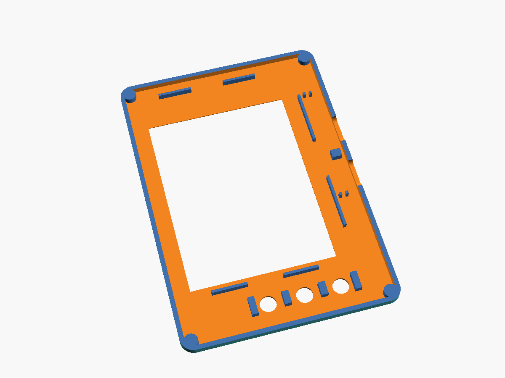

# Printing the case (Bambu Lab A1 mini)

Every part fits the A1 mini's 180 × 180 mm plate (the largest, the bezel and back shell, are about 95 × 137 mm).

## Before the real print
1. Measure your display module with calipers and update the `disp`/`mod_*`/`panel_*`/`active_*` values in [`cad/params.scad`](../cad/params.scad).
2. Run `make -C cad` — it exports the STLs to `cad/stl/` and runs the collision check.
   The back shell carries an engraved label, `e-reader` by default. Change `label` in `cad/params.scad`
   (`""` for none), or set it for one build: `make -C cad LABEL="Night Reader"` (no apostrophes or quotes in the text).
3. Print **`fit_test.stl`** (front face + display ribs, ~20 min). Drop the display in: the active area must be centred in the window and the module must slide in without force. Adjust `active_off_*`, `window_margin` or `gap`, then re-export.

   

## Bambu Studio settings
| Part | Plate | Orientation | Settings |
|---|---|---|---|
| `bezel.stl` | **Textured PEI** (gives the front a matte finish) | front face down, as exported | 0.20 mm Standard, 3 walls, 15 % gyroid, no supports. "Ironing" off. |
| `back.stl` | Textured PEI | outside face down (export is already flipped) | 0.20 mm Standard, 3 walls, 15 % gyroid, no supports |
| `chassis.stl` | Any | flat, as exported | 0.20 mm, 2 walls, 20 % infill |
| `buttons.stl` | Smooth or textured | flange down | 0.12 mm Fine, 100 % infill (they are tiny), brim off |
| `fit_test.stl` | Any | face down | 0.20 mm Draft |

- **Material:** PLA works; PETG is tougher for the button flexing and snap fits. Matte black or dark grey PLA looks best around e-paper.
- **Filament use:** about 55 g total.
- Use **Arachne** wall generator (the Bambu default) so the thin ribs print cleanly.
- If button caps stick in their holes, raise `hole_tol` to 0.3–0.35 mm.

## Post-processing
- Press the 4 M2 heat-set inserts into the bezel's corner bosses (soldering iron ~220 °C for PLA, ~245 °C for PETG). Push them slightly below flush.
- Clean the window edge with a deburring tool if there is elephant foot.
