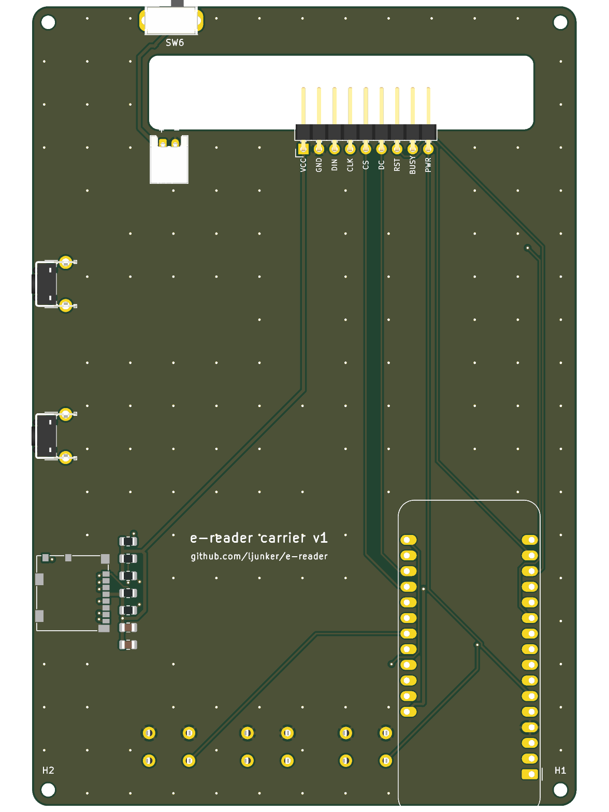
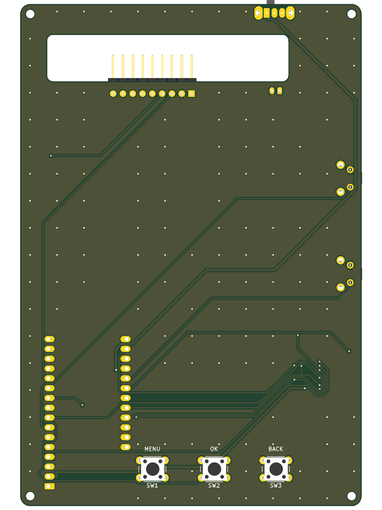

# Carrier board

A 2-layer board (88.5 × 130 mm, 1.6 mm) that replaces the hand wiring. It takes the
place of the old chassis plate: it sits behind the display, clamped between the
front frame's screw bosses and the back shell.

| Back side (towards the back shell) | Front side (towards the display) |
|---|---|
|  |  |

- **Back side:** FeatherS3 on plain pin headers, microSD socket (card goes in through the
  right side wall), page-turn buttons at the right edge, power switch (top edge),
  battery connector, 1×9 header for the display cable.
- **Front side:** MENU / OK / BACK buttons under the screen.
- GND pour on both layers, 0.25 mm signal and 0.5 mm power tracks, nothing finer than 0.15 mm.
- The GPIO assignment is the same as in [`wiring.md`](../../wiring.md), so the firmware is unchanged.

## Ordering (JLCPCB or similar)
Upload [`fab/carrier-gerbers.zip`](fab/carrier-gerbers.zip). Settings: 2 layers, 1.6 mm FR-4,
HASL lead-free or ENIG, any solder mask colour; all other settings default. No assembly
needed; everything is hand-solderable. Parts: [`fab/carrier-bom.csv`](fab/carrier-bom.csv)
and the [project BOM](../../BOM.md).

Schematic: [`fab/carrier-schematic.pdf`](fab/carrier-schematic.pdf).
3D model for checking against the case: `fab/carrier.step`.

## Soldering order
1. microSD socket J1 (1.1 mm pitch; tack one shield pad, align, then the rest), R1–R5, C1, C2.
2. Front buttons SW1–SW3 on the **front** side, side buttons SW4/SW5, power switch SW6,
   battery connector J2, display header J3 on the **back** side.
3. FeatherS3: put the 16- and 12-pin headers into the board (plastic spacer on the back side),
   put the Feather on top and solder both ends.
4. Trim all through-hole leads on the **display side** to ≤ 1 mm and cover them with Kapton
   tape. The display sits 3 mm away.

## Before ordering, check against the real parts
- **microSD orientation:** the card is assumed to go in on the footprint's +Y side (Molex 104031-0811).
  Compare with the datasheet drawing.
- **Side buttons:** `side_act_h` (actuator height above the board, 3.5 mm) in `cad/params.scad`
  must match the switch you buy. It sets the height of the button holes.
- **FeatherS3 header:** the two Feather pins that the board leaves unused (3 and 16) are only
  marked "unconnected" here, so their exact function on the FeatherS3 doesn't matter.

## Regenerating
Everything is generated from [`design.py`](design.py) (parts, nets, placement) and
`cad/params.scad` (outline, button and connector positions). Don't edit the KiCad files by hand;
change the sources and run:

```bash
make            # place + autoroute (Freerouting), schematic, ERC/DRC/parity check, fab outputs
make pcb        # only place + route
make check      # ERC, DRC with schematic parity
```

Needs KiCad 10 (its bundled Python runs `generate_pcb.py` and `route.py`), Java 17+ and the
GitHub CLI (fetches Freerouting into `.tools/` on first use). Freerouting's result varies
between runs, so `route.py` retries up to 5 times until KiCad reports every connection made.
